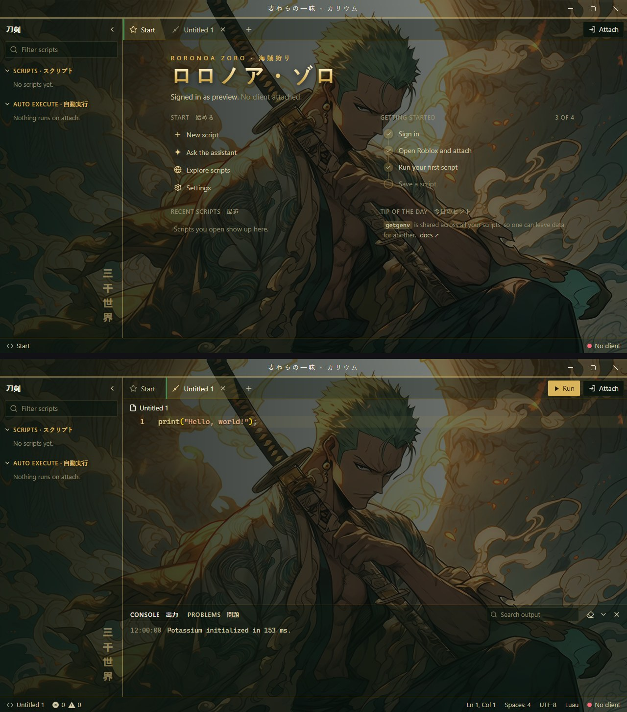
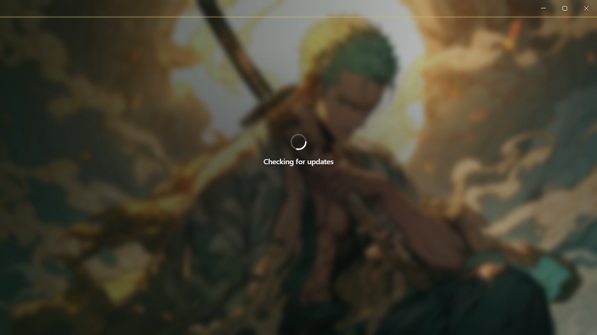
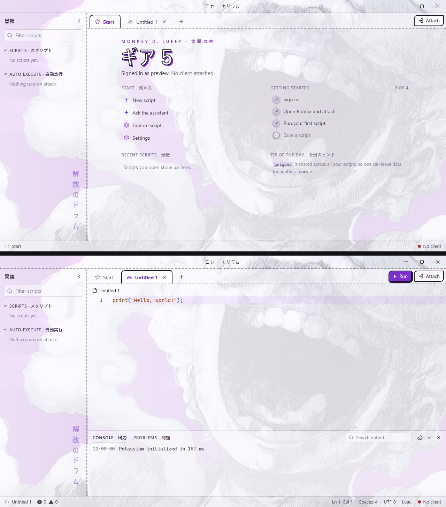
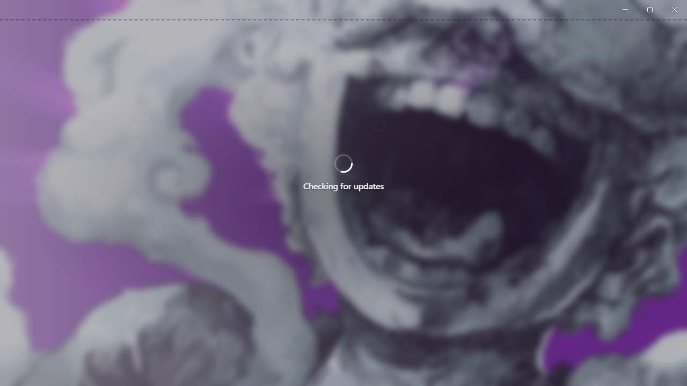
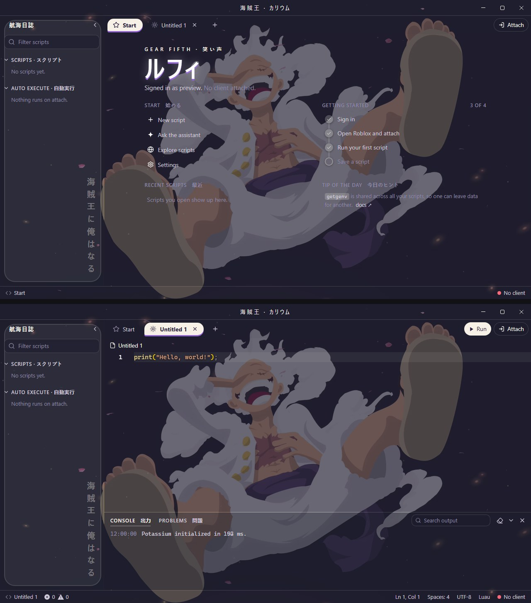
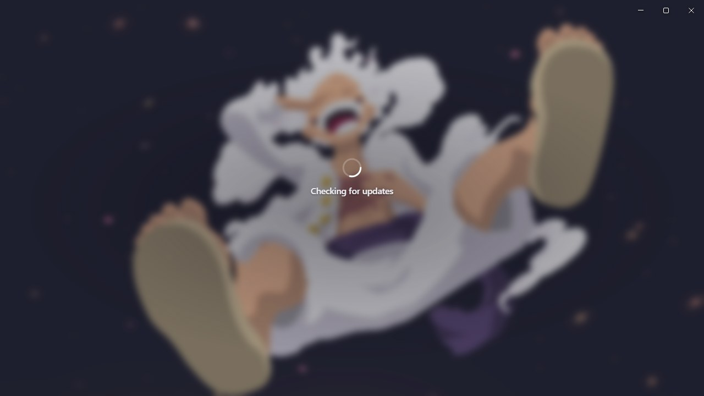

# One Piece themes for Potassium

Three animated One Piece themes for the Potassium executor. Each one has its own colour palette, its own layout and its own Japanese labels, with a looping wallpaper playing behind the whole app.

| Theme | Base theme | Look |
|---|---|---|
| [Zoro · Samurai](#zoro--samurai) | Dark | Green and gold ink, sword-edge tabs, gold double rules, gilded heading |
| [Luffy Gear 5 · Sketch](#luffy-gear-5--sketch) | **Light** | Sketchbook paper, pencil-dashed borders, purple ink, hand-drawn tabs |
| [Luffy Gear 5 · Minimalist](#luffy-gear-5--minimalist) | Dark | Night-navy and cloud white, bubbly rounded panels, bouncing pill tabs |

Previews are animated (AVIF) and show the Start page, a script tab and the loading screen at full size. Browsers that can't play AVIF show a still screenshot instead.

## Install

1. In Potassium, open **Settings → Appearance → Custom theme**.
2. Set **Base theme** to the one listed for that theme (Dark or **Light**). The editor's syntax colours come from the base theme.
3. Open the theme's folder, copy everything in its `Theme.css` and paste it into **Custom CSS**.
4. Type a name under **Save** and click **Save**.

## Loading screen

Every theme also replaces Potassium's own loading and login picture with its wallpaper, softly blurred, so the theme starts the moment the app opens. Each theme's loading screen is shown under its preview.

## Labels in every theme

| Text | Reading | Meaning |
|---|---|---|
| カリウム | karyūmu | Potassium |
| スクリプト | sukuriputo | Scripts |
| 自動実行 | jidō jikkō | Auto execute |
| 出力 | shutsuryoku | Output (console) |
| 問題 | mondai | Problems |
| 始める | hajimeru | Start |
| 最近 | saikin | Recent |
| 今日のヒント | kyō no hinto | Tip of the day |

Each theme below also has its own text; open **What the Japanese means** under its preview.

## Zoro · Samurai

<picture>
  <source srcset="zoro/ui.avif" type="image/avif">
  
</picture>

<picture>
  <source srcset="zoro/loading.avif" type="image/avif">
  
</picture>

[`Theme.css`](zoro/Theme.css) · Base: Dark · 麦わらの一味 · 刀剣 · 三千世界

What the Japanese means

| Text | Reading | Meaning |
|---|---|---|
| 麦わらの一味 | Mugiwara no Ichimi | The Straw Hat Pirates (title bar) |
| 刀剣 | tōken | Swords (explorer) |
| 海賊狩り | kaizoku-gari | Pirate Hunter, his old nickname |
| ロロノア・ゾロ | Roronoa Zoro | His name |
| 三千世界 | Sanzen Sekai | Three Thousand Worlds, his signature three-sword technique |

## Luffy Gear 5 · Sketch

<picture>
  <source srcset="luffy-sketch/ui.avif" type="image/avif">
  
</picture>

<picture>
  <source srcset="luffy-sketch/loading.avif" type="image/avif">
  
</picture>

[`Theme.css`](luffy-sketch/Theme.css) · Base: **Light** · ニカ · 冒険 · 解放のドラム

What the Japanese means

| Text | Reading | Meaning |
|---|---|---|
| ニカ | Nika | The Sun God Nika, the legend behind Gear 5 (title bar) |
| 冒険 | bōken | Adventure (explorer) |
| 太陽の神 | taiyō no kami | Sun God |
| ギア５ | gia faibu | Gear 5 |
| 解放のドラム | kaihō no doramu | Drums of Liberation, the heartbeat of Gear 5 |

## Luffy Gear 5 · Minimalist

<picture>
  <source srcset="luffy-mini/ui.avif" type="image/avif">
  
</picture>

<picture>
  <source srcset="luffy-mini/loading.avif" type="image/avif">
  
</picture>

[`Theme.css`](luffy-mini/Theme.css) · Base: Dark · 海賊王 · 航海日誌 · 海賊王に俺はなる

What the Japanese means

| Text | Reading | Meaning |
|---|---|---|
| 海賊王 | kaizoku-ō | King of the Pirates (title bar) |
| 航海日誌 | kōkai nisshi | Ship's log (explorer) |
| 笑い声 | waraigoe | Laughter |
| ルフィ | Rufi | Luffy |
| 海賊王に俺はなる | kaizoku-ō ni ore wa naru | "I'm gonna be King of the Pirates!", his catchphrase |

## Notes

- Wallpapers are animated AVIF files loaded from this repo, so you need internet the first time. If a wallpaper can't load, the colours still apply.
- Potassium cuts custom CSS off at 50,000 characters. Each theme is about 6,500, so there's room for your own tweaks.
- The layouts target Potassium's internal class names. A future Potassium update could rename them; if that happens, the colours keep working but some layout touches may not.

## Credits

One Piece and its characters belong to Eiichiro Oda, Shueisha and Toei Animation. The wallpapers are converted from live wallpapers posted on [WallpaperWaifu](https://wallpaperwaifu.com):
[Zoro Samurai](https://wallpaperwaifu.com/anime/zoro-samurai-one-piece-live-wallpaper-2690/),
[Luffy Gear 5 Laughing Sketch](https://wallpaperwaifu.com/anime/luffy-gear-5-laughing-sketch-live-wallpaper-2606/),
[Luffy Gear 5 Laughing Minimalist](https://wallpaperwaifu.com/anime/luffy-gear-5-laughing-minimalist-one-piece-live-wallpaper-2432/).
